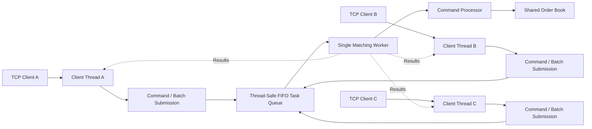

# Latency Lab

A C++20 project for studying trading systems, concurrent networking, correctness, and Linux performance analysis.

## Overview

Latency Lab implements a limit order book with price-time priority, a concurrent TCP server, automated verification, and performance benchmarking.

## Architecture



Network clients communicate concurrently, while a single matching worker processes queued tasks sequentially.

Each task contains one or more commands. Commands within a task execute sequentially, preserving their order. Tasks execute in queue submission order, but concurrent clients may produce different interleavings across runs.

The local CLI and benchmark use separate order book instances.

## Current Features

- Limit order book with price-time priority
- Buy and sell limit orders
- Partial and full fills
- Order cancellation
- Deterministic matching for a given command order
- C++ correctness test cases
- Python reference model and differential testing
- TCP server with persistent in-memory order book
- Concurrent TCP clients with serialized matching
- TCP integration and concurrency testing
- Matching engine latency and throughput benchmarking
- Interactive command-line interface
- TCP end-to-end latency and throughput benchmarking
- Configurable TCP_NODELAY
- Configurable worker batching (up to 32 commands per task)
- Batched TCP response handling

## Build

```sh
cmake -S . -B build -DCMAKE_BUILD_TYPE=Release
cmake --build build -j"$(nproc)"
```

## Run

Start the interactive CLI:

```sh
./build/latency_cli
```

Start the TCP server:

```sh
./build/latency_server
```

The TCP server listens on `127.0.0.1:9000` by default.

Supported commands:

- `BUY <id> <price> <quantity>`
- `SELL <id> <price> <quantity>`
- `CANCEL <id>`
- `BOOK`
- `QUIT`

Each command must end with a newline.
Each response ends with an `END` line.

The TCP server supports concurrent clients sharing one in-memory order book.

## Testing

Run all automated test suites:

```sh
ctest --test-dir build --output-on-failure
```

The test suites cover:

- C++ order book correctness
- Python reference model and randomized differential testing
- TCP server integration
- Concurrent TCP clients
- Matching and TCP benchmark smoke testing
- TCP_NODELAY regression testing
- Worker batching regression testing
- Pipelined commands, price-time priority, and QUIT handling

All 11 CTest suites pass in the tested Ubuntu environment.

## Performance Benchmarking

Run the matching engine benchmark:

```sh
./build/latency_bench 50000
```

The benchmark reports:

- p50, p95, and p99 matching latency
- Mean matching latency
- Single-threaded order processing throughput
- Matched quantity for correctness checks

Latency measurements cover a crossing buy order against one resting sell order.

Throughput measures repeated sell-then-buy cycles without networking.

Results depend on CPU, compiler, operating system, and virtualization.

## TCP End-to-End Benchmark

Run the TCP benchmark:

```sh
python3 benchmarks/tcp_benchmark.py --server ./build/latency_server
```

The benchmark measures:

- TCP round-trip latency for crossing buy orders
- p50, p95, and p99 latency
- Concurrent TCP throughput
- Expected response validation
- Empty final order book verification

The latency workload uses one outstanding request at a time.

The throughput workload uses multiple clients and batched requests.

Measurements include TCP, scheduling, synchronization, and client-side overhead. Results are environment-dependent and should not be interpreted as matching engine latency alone.

Concurrent clients share the same order book. Orders from different clients may match each other, and their execution order depends on task submission and batching.

The current benchmark does not perform full differential verification of concurrent execution traces.

## TCP_NODELAY Experiment

The TCP server supports an optional `TCP_NODELAY` configuration:

```sh
LATENCY_TCP_NODELAY=1 ./build/latency_server
```

The option disables Nagle's algorithm on accepted client sockets.

### Experimental Results

Five paired experiments were conducted on Ubuntu running inside VirtualBox, using four concurrent TCP clients, 10,000 commands per run, and 20 order pairs per batch.

| Metric | TCP_NODELAY OFF | TCP_NODELAY ON |
|---|---:|---:|
| Median p50 latency | 96.80 us | 96.49 us |
| Median p99 latency | 355.62 us | 389.64 us |
| Median throughput | 3,689.70 orders/s | 50,242.59 orders/s |

Enabling `TCP_NODELAY` increased median throughput by approximately 13.6x for this workload.

Median p50 latency remained nearly unchanged, while median p99 latency was slightly higher.

The results suggest that TCP buffering behavior contributes to throughput limitations in the current request-response protocol. Additional profiling is needed to establish the underlying mechanism.

These measurements are specific to the benchmark workload and virtualized environment.

## Worker Batching Experiment

The TCP server supports optional command batching:

```sh
LATENCY_TCP_NODELAY=1 LATENCY_WORKER_BATCH=1 ./build/latency_server
```

Network batching and worker batching are separate mechanisms.
Network batching controls how many order pairs the benchmark
client sends together, while worker batching controls how many
complete commands the server processes in one worker task.

When enabled, the server groups up to 32 complete commands from one client into a single matching worker task.

The matching worker processes each batch sequentially. Command order is preserved within each client, while interleaving between clients may change.

### Experimental Results

Five paired experiments were conducted on Ubuntu VirtualBox with four concurrent TCP clients, 10,000 commands per run, 20 order pairs per network batch, and `TCP_NODELAY` enabled.

| Metric | Batching OFF | Batching ON |
|---|---:|---:|
| Median p50 latency | 123.52 us | 127.08 us |
| Median p99 latency | 646.54 us | 671.05 us |
| Median throughput | 48,578 orders/s | 220,524 orders/s |

Batching improved median throughput by approximately 4.54x for this workload.

The implementation combines multiple commands into one worker submission and multiple responses into one socket write. Further profiling is needed to quantify the contribution of each change.

Results are specific to the tested workload and virtualized environment.

### Linux Performance Profiling

We used Linux `perf stat` to compare worker batching with
`TCP_NODELAY` enabled.

Each configuration was measured three times using four
concurrent TCP clients and 100,000 commands per run.

| Metric | Batching OFF | Batching ON | Change |
|---|---:|---:|---:|
| CPU time | 6,040 ms | 1,289 ms | -78.7% |
| Context switches | 261,414 | 25,665 | -90.2% |
| CPU migrations | 49,542 | 5,930 | -88.0% |
| Page faults | 3,610 | 3,638 | +0.8% |
| Elapsed time | 2.257 s | 0.673 s | -70.2% |
| Median throughput | 44,819 orders/s | 195,174 orders/s | 4.35x |

Performance counters include both the Python benchmark
client and the C++ TCP server.

The reduction in context switches is consistent with lower
synchronization and scheduling overhead.

Worker batching also combines multiple responses into
fewer socket writes, so the individual contribution of
each optimization has not yet been isolated.

Measurements were collected inside an Ubuntu VirtualBox VM.

### eBPF Scheduler Observability

We used `bpftrace` with the Linux `sched_wakeup` and
`sched_switch` tracepoints to observe server scheduling.

The workload used four concurrent clients, 100,000 commands,
and `TCP_NODELAY` enabled.

| Metric | Batching OFF | Batching ON |
|---|---:|---:|
| Server wakeups | 129,986 | 11,459 |
| TCP throughput | 62,011 orders/s | 269,238 orders/s |
| Wakeup-to-running p50 bucket | 2-4 us | 1-2 us |
| Wakeup-to-running p95 bucket | 16-32 us | 8-16 us |

Worker batching reduced observed server wakeups by 91.2%
in this measurement.

The scheduler measurements support the earlier `perf stat`
results, which showed fewer context switches with batching.

These eBPF results are from one run per configuration.
Additional runs are needed to evaluate their stability.

## Planned Features

- UDP market data distribution
- Performance evaluation across client counts and batch sizes
- Concurrent client fairness analysis
- Additional correctness testing under concurrent workloads
- Further profiling-guided optimization