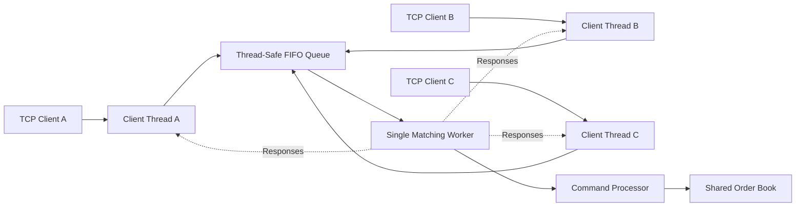

# Latency Lab

A C++20 project for studying trading systems, concurrent networking, correctness, and Linux performance analysis.

## Overview

Latency Lab implements a limit order book with price-time priority, a concurrent TCP server, automated verification, and performance benchmarking.

## Architecture



Network clients communicate concurrently, while one matching worker processes queued commands sequentially.

The order book follows the queue submission order. Commands submitted simultaneously by different clients may arrive in different orders across runs.

The local CLI and benchmark use their own order book instances, separate from the TCP server.

## Current Features

- Limit order book with price-time priority
- Buy and sell limit orders
- Partial and full fills
- Order cancellation
- Deterministic matching for a given command order
- C++ correctness test cases
- Python reference model and differential testing
- TCP server with persistent in-memory order book
- Concurrent TCP clients with serialized matching
- TCP integration and concurrency testing
- Matching engine latency and throughput benchmarking
- Interactive command-line interface
- TCP end-to-end latency and throughput benchmarking

## Build

```sh
cmake -S . -B build -DCMAKE_BUILD_TYPE=Release
cmake --build build -j"$(nproc)"
```

## Run

Start the interactive CLI:

```sh
./build/latency_cli
```

Start the TCP server:

```sh
./build/latency_server
```

The TCP server listens on `127.0.0.1:9000` by default.

Supported commands:

- `BUY <id> <price> <quantity>`
- `SELL <id> <price> <quantity>`
- `CANCEL <id>`
- `BOOK`
- `QUIT`

Each command must end with a newline.
Each response ends with an `END` line.

The TCP server supports concurrent clients sharing one in-memory order book.

## Testing

Run all automated test suites:

```sh
ctest --test-dir build --output-on-failure
```

The test suites cover:

- C++ order book correctness
- Python differential testing
- TCP server integration
- Concurrent TCP clients
- Benchmark smoke testing

## Performance Benchmarking

Run the matching engine benchmark:

```sh
./build/latency_bench 50000
```

The benchmark reports:

- p50, p95, and p99 matching latency
- Mean matching latency
- Single-threaded order processing throughput
- Matched quantity for correctness checks

Latency measurements cover a crossing buy order against one resting sell order.

Throughput measures repeated sell-then-buy cycles without networking.

Results depend on CPU, compiler, operating system, and virtualization.

## Planned Features

- UDP market data distribution
- Linux perf and eBPF diagnostics
- Performance optimization based on profiling
- Reproducible benchmark reports

## TCP End-to-End Benchmark

Run the TCP benchmark:

```sh
python3 benchmarks/tcp_benchmark.py --server ./build/latency_server
```

The benchmark measures:

- TCP round-trip latency for crossing buy orders
- p50, p95, and p99 latency
- Concurrent TCP throughput
- Response correctness and final order book consistency

The latency workload uses one outstanding request at a time.

The throughput workload uses multiple clients and batched requests.

Measurements include TCP, scheduling, synchronization, and client-side overhead. Results are environment-dependent and should not be interpreted as matching engine latency alone.

## TCP_NODELAY Experiment

The TCP server supports an optional `TCP_NODELAY` configuration:

```sh
LATENCY_TCP_NODELAY=1 ./build/latency_server
```

The option disables Nagle's algorithm on accepted client sockets.

### Experimental Results

Five paired experiments were conducted on Ubuntu running inside VirtualBox, using four concurrent TCP clients, 10,000 commands per run, and 20 order pairs per batch.

| Metric | TCP_NODELAY OFF | TCP_NODELAY ON |
|---|---:|---:|
| Median p50 latency | 96.80 us | 96.49 us |
| Median p99 latency | 355.62 us | 389.64 us |
| Median throughput | 3,689.70 orders/s | 50,242.59 orders/s |

Enabling `TCP_NODELAY` increased median throughput by approximately 13.6x for this workload.

Median p50 latency remained nearly unchanged, while median p99 latency was slightly higher.

The results suggest that TCP buffering behavior contributes to throughput limitations in the current request-response protocol. Additional profiling is needed to establish the underlying mechanism.

These measurements are specific to the benchmark workload and virtualized environment.
